# 02 — Sơ đồ dữ liệu (ERD) — Web bán hàng nội thất

> Cơ sở dữ liệu: **MongoDB** (document). Quy ước: quan hệ `||--o{` = 1-nhiều. Các document con ghi `(embedded)` nằm lồng trong document cha, không phải collection riêng.

## 1. Quyết định embedding vs referencing

| Quan hệ | Cách lưu | Lý do |
|---------|----------|-------|
| User → Address | Embedded `addresses[]` | Địa chỉ luôn đi kèm user, ít, cập nhật cùng lúc |
| Product → ProductImage | Embedded `images[]` | Ảnh thuộc về sản phẩm, đọc cùng lúc |
| Order → OrderItem | Embedded `items[]` (snapshot) | **Snapshot giá/tên tại lúc đặt** — giá sau này đổi không ảnh hưởng đơn cũ |
| Order → StatusHistory | Embedded | Truy vết nội bộ của đơn |
| Cart → CartItem | Embedded `items[]` | Giỏ là một document gọn |
| Category → Category con | Reference `parentId` | Cây danh mục truy vấn đệ quy |
| Product → ProductVariant | Collection riêng | Biến thể có SKU/tồn kho riêng, cập nhật độc lập, query tồn kho nguyên tử |
| Product → Review | Collection riêng | Phân trang, lọc, kiểm duyệt độc lập |
| User → Order / WishlistItem | Collection riêng + `userId` | Số lượng lớn, query theo user có index |

## 2. Sơ đồ quan hệ (mermaid)

```mermaid
erDiagram
    USER ||--o{ ADDRESS : "có (embedded)"
    USER ||--o| CART : "sở hữu"
    USER ||--o{ ORDER : "đặt"
    USER ||--o{ REVIEW : "viết"
    USER ||--o{ WISHLIST_ITEM : "lưu"
    CATEGORY ||--o{ CATEGORY : "cha-con (parentId)"
    CATEGORY ||--o{ PRODUCT : "chứa"
    PRODUCT ||--o{ PRODUCT_VARIANT : "có biến thể"
    PRODUCT ||--o{ REVIEW : "nhận"
    PRODUCT ||--o{ WISHLIST_ITEM : "được lưu"
    PRODUCT_VARIANT ||--o{ CART_ITEM : "trong giỏ (embedded)"
    PRODUCT_VARIANT ||--o{ ORDER_ITEM : "snapshot trong đơn (embedded)"
    ORDER ||--o{ ORDER_ITEM : "gồm (embedded)"
    ORDER ||--o| PAYMENT : "thanh toán"
    ORDER }o--|| VOUCHER : "áp dụng (voucherCode)"
    VOUCHER ||--o{ ORDER : "cho"

    USER {
        ObjectId _id PK
        string email UK "unique, lowercase"
        string passwordHash "null nếu login Google"
        string fullName
        string phone "bắt buộc, unique"
        boolean phoneVerified "bắt buộc true trước khi đặt hàng (QĐ 2026-10-10)"
        string[] roles "ROLE_CUSTOMER | ROLE_ADMIN"
        string status "ACTIVE | LOCKED"
        string lockReason "lý do khóa do admin nhập khi khóa tài khoản (không bắt buộc) — bổ sung 2026-10-12 khi implement màn 20 (admin-khach-hang.md §4.2); mở khóa thì xóa"
        string lockedBy "định danh admin đã khóa (userId từ JWT) — bổ sung 2026-10-12 màn 20, phục vụ tra soát"
        datetime lockedAt "thời điểm admin khóa — bổ sung 2026-10-12 màn 20; phân biệt với lockedUntil (hạn tự mở của khóa tự động F-010): khóa admin có lockedUntil = null và KHÔNG bao giờ tự mở (admin-khach-hang.md §4.3/§4.4)"
        datetime createdAt
    }
    ADDRESS {
        string label "Nhà / Công ty..."
        string receiverName
        string phone
        string province
        string district
        string ward
        string detail
        boolean isDefault
    }
    CATEGORY {
        ObjectId _id PK
        string name
        string slug UK
        ObjectId parentId FK "null = danh mục gốc"
        string imageUrl
        int sortOrder
        boolean active
    }
    PRODUCT {
        ObjectId _id PK
        string name
        string slug UK
        ObjectId categoryId FK
        string description
        object specs "map thông số: kích thước tổng, bảo hành..."
        decimal basePrice "giá niêm yết (giá biến thể có thể khác)"
        object badge "nhãn marketing hiển thị: type (new|bestseller|sale) + label (MỚI|BÁN CHẠY|-15%) — bổ sung 2026-10-12 khi implement màn 15 (FE/mock đã dùng từ màn 1)"
        object[] images "embedded: url, sortOrder"
        decimal ratingAvg
        int ratingCount
        int soldCount
        boolean featured "lên trang chủ"
        boolean active
        datetime createdAt
    }
    PRODUCT_VARIANT {
        ObjectId _id PK
        ObjectId productId FK
        string sku UK "mã riêng từng MÀU"
        string color "chiều phân biệt chính — tồn kho/giá theo màu (QĐ 2026-10-10)"
        string colorHex "mã màu hiển thị chấm màu (bổ sung 2026-10-10 khi implement)"
        decimal price "giá bán của màu này"
        int stock "tồn kho theo màu — trừ nguyên tử khi đặt hàng"
        int lowStockThreshold "ngưỡng cảnh báo"
        decimal lengthM "dài (m) — tính diện tích chiếm chỗ"
        decimal widthM "rộng (m) — tính diện tích chiếm chỗ"
        string sizeLabel "vd: 1m8 x 2m (hiển thị)"
        string materialNote "ghi chú chất liệu của màu này (hiển thị, không tách kho)"
    }
    REVIEW {
        ObjectId _id PK
        ObjectId productId FK
        ObjectId userId FK
        ObjectId orderId FK "đơn đã HOÀN THÀNH tương ứng"
        int rating "1-5"
        string comment
        string[] images
        datetime createdAt
    }
    WISHLIST_ITEM {
        ObjectId _id PK
        ObjectId userId FK
        ObjectId productId FK
        datetime createdAt
    }
    CART {
        ObjectId _id PK
        ObjectId userId FK "null = khách vãng lai (dùng sessionId)"
        string sessionId "cho GUEST"
        object[] items "embedded CART_ITEM: variantId, qty, flashSaleProgramId?"
        datetime updatedAt
    }
    VOUCHER {
        ObjectId _id PK
        string code UK "vd: NOITHAT50; chương trình FLASH_SALE: server tự sinh FS-XXXXXX, khách không thấy"
        string name "tên nội bộ chương trình flash sale — CHỈ admin thấy, phía khách không đọc field này; bổ sung 2026-10-12 khi implement màn 22 (admin-flash-sale-shipping.md §10.2); null với voucher thường"
        string type "PERCENT | FIXED | FLASH_SALE"
        decimal value "50 (%) hoặc 100000 (VND)"
        decimal maxDiscount "trần giảm khi type=PERCENT"
        decimal minOrderValue "đơn tối thiểu"
        ObjectId[] applicableCategories "rỗng = mọi danh mục"
        ObjectId[] applicableProductIds "dùng cho flash sale theo sản phẩm"
        datetime startAt
        datetime endAt "flash sale: hết giờ tự đóng"
        int totalUsageLimit "flash sale: giới hạn suất; 0 = KHÔNG giới hạn (convention thống nhất VoucherService + FlashSaleService — bổ sung 2026-10-12 màn 19, admin-voucher.md §9.2)"
        int perUserLimit "giới hạn lượt mỗi khách; null/0 = không giới hạn — bổ sung 2026-10-12 khi implement màn 19 (admin-voucher.md §9.1); VoucherService đếm đơn của user theo voucherCode, không tính đơn ĐÃ HỦY/HOÀN TRẢ"
        int usedCount "tăng nguyên tử khi áp thành công"
        boolean active
        object[] items "flash sale [mở rộng 2026-10-12]: productId, variantId?, flashPrice|discountPercent, maxDiscount?, itemQuota, itemSoldCount"
    }
    ORDER {
        ObjectId _id PK
        string orderNumber UK "vd: NT-20261010-0001"
        ObjectId userId FK "bắt buộc — không guest checkout (QĐ 2026-10-10)"
        object[] items "embedded ORDER_ITEM snapshot: variantId, sku, productName, color, price, qty, areaM2, flashSaleProgramId?"
        decimal subtotal
        decimal discount
        decimal shippingFee "tính theo tổng diện tích (FR-029)"
        decimal total
        string voucherCode
        object receiver "snapshot: name, phone, province, district, ward, detail"
        string status "MỚI|ĐÃ XÁC NHẬN|ĐANG GIAO|HOÀN THÀNH|ĐÃ HỦY|HOÀN TRẢ"
        object[] statusHistory "embedded: status, at, note, bySystem (true = mốc do hệ thống tạo — bổ sung 2026-10-12 màn 17)"
        string paymentMethod "COD | BANK_TRANSFER | MOMO"
        string note
        string adminNote "ghi chú nội bộ admin — không hiện cho khách (bổ sung 2026-10-12 khi implement màn 17, admin-don-hang.md §3.8)"
        string trackingCode "mã vận đơn khi ĐANG GIAO (bổ sung 2026-10-12 khi implement màn 17, admin-don-hang.md §4.4)"
        datetime createdAt
    }
    PAYMENT {
        ObjectId _id PK
        ObjectId orderId FK
        string method "COD | BANK_TRANSFER | MOMO"
        decimal amount
        string status "CHƯA THANH TOÁN | ĐÃ THANH TOÁN | THẤT BẠI | HOÀN TIỀN"
        string providerRef "MoMo transId / nội dung CK"
        string momoOrderId "orderId gửi sang MoMo"
        datetime paidAt
    }
    SHIPPING_RULE {
        ObjectId _id PK
        decimal minAreaM2 "diện tích từ"
        decimal maxAreaM2 "diện tích đến (null = không giới hạn)"
        decimal fee "phí VND cho nấc này"
        boolean active
    }
    SHIPPING_CONFIG {
        ObjectId _id PK "document đơn nhất, key cố định = SHIPPING"
        string key UK "SHIPPING"
        decimal freeThreshold "ngưỡng tạm tính được miễn phí ship (VND) — cấu hình admin sửa được; bổ sung 2026-10-12 khi implement màn 22 (admin-flash-sale-shipping.md §10.3), thay hằng hardcode ShippingService.FREE_SHIPPING_THRESHOLD; chưa có document -> mặc định 10.000.000"
    }
    BANNER {
        ObjectId _id PK
        string imageUrl
        string linkUrl
        string title "text overlay hero (bổ sung 2026-10-10 khi implement)"
        string subtitle
        string ctaText "chữ nút CTA"
        int sortOrder
        boolean active
    }
```

## 3. Ràng buộc & index chính

- **Unique:** `User.email`, `Category.slug`, `Product.slug`, `ProductVariant.sku`, `Voucher.code`, `Order.orderNumber`.
- **Index truy vấn:** `Product{categoryId, active}`, `ProductVariant{productId}`, `Review{productId, createdAt}`, `Order{userId, createdAt}`, `Order{status}`, `WishlistItem{userId}`, `Voucher{code, active}`.
- **Nguyên tử (số tiền/tồn kho):** trừ `ProductVariant.stock` và tăng `Voucher.usedCount` phải dùng cập nhật có điều kiện (`stock >= qty`) trong cùng thao tác tạo đơn — hết hàng → từ chối đơn, không cho âm kho (FR-011).
- **Snapshot trong đơn:** `ORDER_ITEM` và `receiver` là bản chụp tại lúc đặt — thay đổi giá/tên sản phẩm sau này không làm sai lệch đơn cũ.
- **Review 1 lần:** unique compound `Review{productId, userId}` + bắt buộc `orderId` ở trạng thái HOÀN THÀNH (FR-017).
- **SĐT:** unique `User.phone`; `phoneVerified` bắt buộc `true` trước checkout (FR-030).
- **OTP (F-024):** collection `otps` (mới) — unique `OtpCode.phone`, TTL tự xóa trên `expiresAt`; mã lưu dạng hash bcrypt, không lưu plain; khóa đăng nhập: `User.failedLoginAttempts` + `User.lockedUntil` (sai 5 lần → LOCKED 15 phút, F-010); đặt lại mật khẩu: `User.passwordResetToken` + `passwordResetTokenExpiry` (30 phút).

## 4. Bảng tham khảo diện tích chiếm chỗ (phục vụ tính phí ship FR-029)

Diện tích = dài × rộng của sản phẩm (m²), lấy từ `ProductVariant.lengthM/widthM`. Số liệu tham khảo để admin nhập liệu ban đầu (nghiên cứu 2026-10-10):

| Nhóm sản phẩm | Kích thước điển hình | Diện tích |
|---|---|---|
| Sofa băng 2 chỗ | 1.8 × 0.9 m | ~1.6 m² |
| Sofa góc L | 2.4 × 1.6 m | ~3.8 m² |
| Giường 1m8 | 1.8 × 2.0 m | ~3.6 m² |
| Giường 1m6 | 1.6 × 2.0 m | ~3.2 m² |
| Bàn ăn 6 ghế | 1.8 × 0.9 m | ~1.6 m² |
| Tủ quần áo 3 cánh | 1.8 × 0.6 m | ~1.1 m² |
| Kệ tivi | 1.8 × 0.4 m | ~0.7 m² |
| Bàn làm việc | 1.2 × 0.6 m | ~0.7 m² |
| Ghế ăn (1 chiếc) | 0.45 × 0.5 m | ~0.2 m² |
| Đèn / đồ decor | — | < 0.3 m² |

Bảng phí đề xuất ban đầu (admin cấu hình được trong `SHIPPING_RULE`, đơn vị VND):

| Tổng diện tích đơn | Phí ship |
|---|---|
| ≤ 1 m² | 100.000 |
| 1 – 3 m² | 200.000 |
| 3 – 6 m² | 350.000 |
| 6 – 10 m² | 550.000 |
| > 10 m² | Liên hệ báo giá (hoặc 800.000 — admin chọn) |

**[Giả định]:** miễn phí vận chuyển cho đơn ≥ 10.000.000đ trong nội thành; ngưỡng này admin cấu hình được — từ màn 22 (2026-10-12) ngưỡng lưu trong collection `shipping_configs` (entity `SHIPPING_CONFIG`, document đơn nhất `key = SHIPPING`, field `freeThreshold`); `ShippingService` đọc cấu hình này thay cho hằng hardcode, mặc định 10.000.000đ khi chưa có cấu hình. Trần diện tích 10 m² (`MAX_AREA_M2`) vẫn là hằng hardcode chỉ-đọc.
